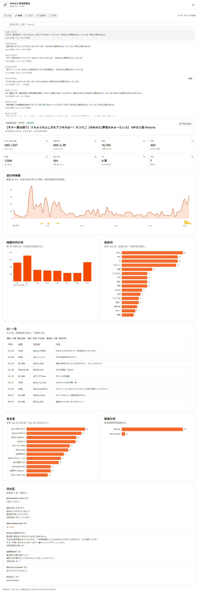

# ゆめみた 配信数据台

把 **夢限大みゅーたいぷ** 成员直播的归一化 JSON 做成可交互的数据可视化页面：同接、弹幕密度、SC、评论、词频与跨场对比。

当前内置数据集：**宮永ののか**，**262 场**不重复直播（2023-11-19 – 2026-10-22，持续补历史场次）。

> **数据全部放在对象存储**（Cloudflare R2 等）：`manifest.json`、`insights.json` 与逐场 datapack。
> git 里只有代码和 `data-sources.json` 配置，`bun run publish:data` 是唯一的写入入口。
> 构建时拉取索引与预聚合，页面内只做局部计算。

## 界面




> 截图为早期 48 场快照；当前数据集 262 场。右上角可切换深浅色主题。

## 功能

- **成员首页**：最近一场、本月变化、最近场次、更新日历（按日看场次 / 弹幕 / SC 热度）、内容构成、全期高频词与发言者、典型节奏曲线。
- **场次页**：完整表格、搜索、内容类型筛选、仅有 VSTATS、排序、导出 CSV；筛选与排序写进 URL。
- **趋势页**：月度趋势（场次 / 弹幕每分 / SC / 平均同接）、月度明细、内容类型对比。
- **单场详情**：概览 / 时间轴 / 弹幕与词 / 付费 / 评论五个子视图；子视图可深链。
- **对比**：最多选 4 场，逐分钟弹幕叠加对比 + 指标横表（最高值加粗）。
- **说明**：数据口径、已知限制、更新方式。
- **导航**：侧边栏 + 移动端底部标签栏；单场/对比/子视图有独立 URL，可刷新、分享、前进后退。
- **效率**：`j` / `k` 翻场、`1`–`5` 切页、`/` 搜索、`⌘K` 全局搜索场次与成员。
- 深色/浅色主题、响应式布局、多成员数据结构（当前接入 1 位）。

## 快速开始

需要 **Bun ≥ 1.4**（推荐）和 Node.js ≥ 22.22。

```bash
bun install
bun run dev
# http://localhost:5173
```

`dev` 会先运行 `sync:data`：配了 `VITE_DATAPACK_BASE` 就从对象存储拉索引与预聚合（带本地缓存），没配就用本地 `data/` 暂存区。单场 datapack 由浏览器按需向对象存储请求。

需要连对象存储时，复制 `.env.example` 为 `.env` 并填写 `VITE_DATAPACK_BASE`（构建时注入）；留空则完全走本地 `data/`，离线开发不受影响。上传侧另需 `R2_*` 凭据，可选 `R2_PREFIX` 指定桶内前缀。

### 常用命令

| 命令 | 说明 |
| --- | --- |
| `bun run dev` | 同步数据 + 启动开发服务器 |
| `bun run build` | 同步数据 + 类型检查 + 生产构建（`dist/`） |
| `bun run preview` | 预览生产构建 |
| `bun run sync:data` | 拉取 manifest + insights 到 `public/data/`，生成 dataset 索引 |
| `bun run publish:data` | 由 pack 重建 manifest + insights 并上传对象存储 |
| `bun run validate:data` | 校验 index → manifest → insights；加 `--remote` 检查对象存储 |
| `bun run add:datapack` | 加一份 datapack，自动更新 manifest |
| `bun run typecheck` | TypeScript 类型检查 |
| `bun run test` | Vitest 单元测试 |
| `bun run lint` | oxlint |
| `bun run check` | typecheck + test + lint |
| `bun run ci` | sync + validate + check + build（CI 同款） |

## 数据流

```text
data/<dataset>/*.datapack.json          # 本地暂存（gitignore，唯一真源）
        │
        │  scripts/publish-data.ts
        ▼
manifest.json + insights.json           # 由 pack 派生
        │
        │  上传
        ▼
对象存储（R2）: <base>/<dataset>/manifest.json · insights.json · <videoId>.datapack.json
        │
        │  scripts/sync-data.mjs（构建时拉索引，带本地缓存）
        ▼
public/data/index.json + <dataset>/manifest.json + insights.json
        │
        │  fetch（浏览器）
        ▼
useDatasetIndex → useDataset → StreamSummary[] + DatasetTotals
        │
        ▼
buildStreamRows / aggregateDataset（纯函数）
        │
        ▼
总览 / 单场 / 对比 / 数据表

单场 / 对比：useStreamPacks 直接向对象存储请求 datapack
```

- `data/<id>/*.datapack.json` 是**唯一真源**（本地暂存，不提交）。
- `manifest.json` / `insights.json` 由 `publish:data` 从 pack 派生，与 pack 一起上传，保证索引不会指向不存在的 pack。
- 构建时 `sync:data` 只拉 manifest/insights（带本地缓存），datapack 不进构建产物。
- `public/data/` 是**构建中间产物**，不提交；`data-sources.json` 是唯一入库的数据配置。

## 目录结构

```text
stream-dashboard/
├─ data/                     # 本地暂存区（gitignore，仅 README 入库）
│  ├─ README.md
│  └─ nonoka/*.datapack.json
├─ docs/                     # 架构 / 数据模型 / 开发 / 部署文档
├─ public/data/              # 生成物（gitignore）
├─ scripts/
│  ├─ sync-data.mjs
│  └─ validate-data.mjs
├─ src/
│  ├─ components/
│  │  ├─ charts/             # D3 图表（React 持有 DOM，D3 只算比例尺/路径）
│  │  ├─ dashboard/          # 页面级组件与视图
│  │  └─ ui/                 # coss ui primitives（生成物，避免手改）
│  ├─ hooks/                 # 数据加载、主题、尺寸测量
│  ├─ lib/                   # 纯函数：data / aggregate / format / routes
│  ├─ pages/                 # 路由页面（数据 ↔ 视图 ↔ navigate）
│  ├─ types/                 # datapack / dataset schema 的 TS 镜像
│  ├─ router.tsx             # hash 路由表（createHashRouter）
│  ├─ App.tsx                # RouterProvider
│  └─ index.css              # Tailwind v4 + coss 主题 token
├─ data-sources.json         # dataset 注册表
├─ components.json           # shadcn/coss 配置
└─ vite.config.ts
```

## 技术栈

- **React 19 + Vite + TypeScript**
- **React Router v8**：hash 路由 + 路由级懒加载
- **Tailwind CSS v4** + **coss ui**（Base UI + shadcn 风格组件）
- **D3**：`scale` / `shape` / `pie` / `arc`，只负责数学与路径，不接管 DOM
- **Vitest**：数据聚合与格式化单元测试
- **oxlint**：静态检查

## 增加数据 / 成员

### 加一场直播

1. `bun run add:datapack nonoka /path/to/<videoId>.datapack.json`：写入本地暂存区并 upsert manifest。
2. `bun run publish:data`：由 pack 重建 manifest + insights，并上传对象存储。
3. `bun run sync:data && bun run validate:data`：本地校验。

### 加一位成员

1. 新建 `data/<id>/`，放入该成员的 `<videoId>.datapack.json`。
2. 在 `data-sources.json` 增加一条 dataset。
3. `bun run publish:data --dataset <id>` 生成索引并上传；再 `sync:data`。
4. 页面会自动出现成员入口，不需要改组件。

详细步骤与字段说明见 [docs/adding-data.md](docs/adding-data.md)。

## 部署

```bash
bun run build
# 产物在 dist/，包含 dist/data/
```

部署在 Vercel（构建 `bun run build`，输出 `dist/`）；`vercel.json` 已配好缓存头。构建前设置 `VITE_DATAPACK_BASE` 指向对象存储；子路径部署用 `VITE_BASE`。详见 [docs/deployment.md](docs/deployment.md)。

## 文档

- [docs/README.md](docs/README.md) — 文档索引
- [docs/architecture.md](docs/architecture.md) — 架构与数据流
- [docs/data-model.md](docs/data-model.md) — manifest / datapack 字段与口径
- [docs/adding-data.md](docs/adding-data.md) — 新增场次、成员、数据集
- [docs/data-progress.md](docs/data-progress.md) — 频道历史抓取进度与下一批候选
- [docs/development.md](docs/development.md) — 本地开发、代码规范、图表写法
- [docs/deployment.md](docs/deployment.md) — 构建与静态托管
- [docs/troubleshooting.md](docs/troubleshooting.md) — 常见问题
- [docs/roadmap.md](docs/roadmap.md) — 后续计划

## 数据与内容说明

- 数据来自 YouTube 直播回放、弹幕、评论区与 VSTATS 快照，经 `stream-datapack` 归一化。
- 会员限定内容可能包含不适合公开传播的信息；部署前请自行确认范围与权限。
- 原始内容版权归各自权利人所有，本仓库只做个人研究与分析用途。详见 [NOTICE.md](NOTICE.md)。
