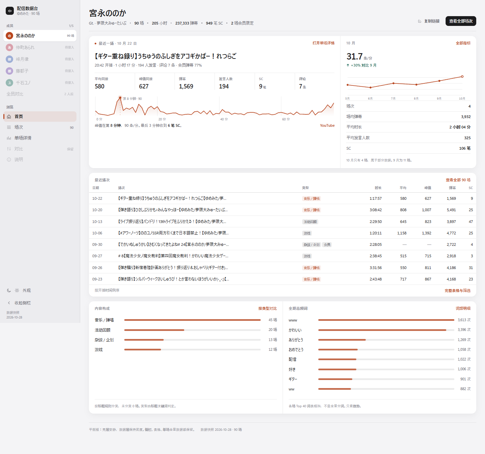
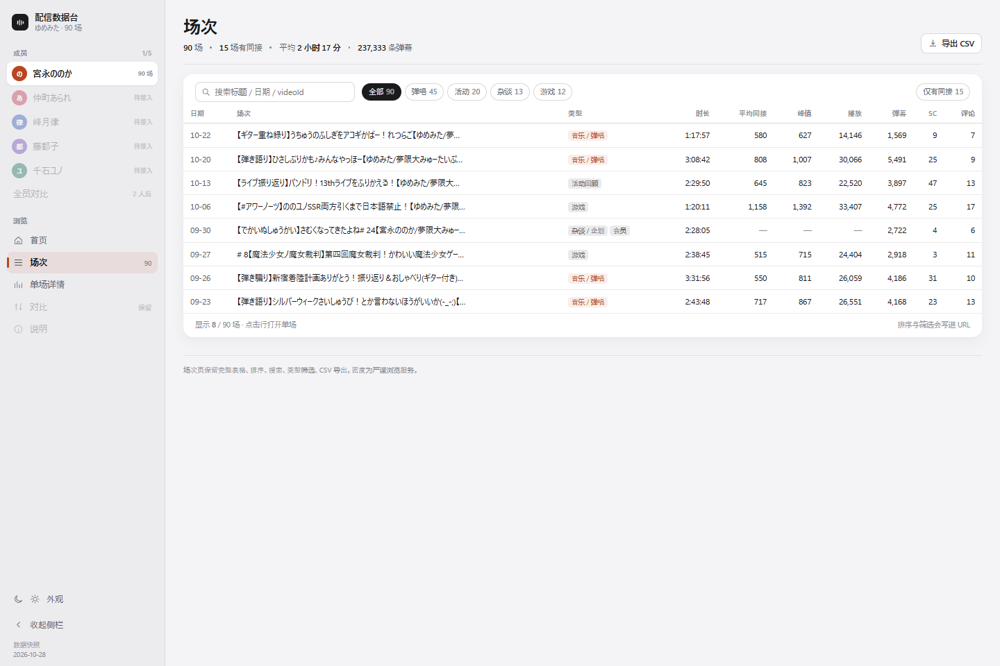
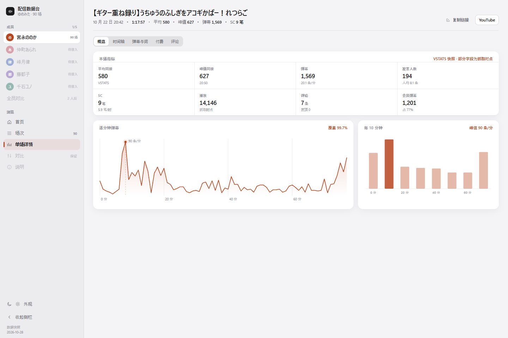

# UI 重构方向：从仪表盘到分层数据产品

| 项 | 内容 |
| --- | --- |
| 状态 | 提案，待评审 |
| 原型 | `.commandcode/design/prototype-v2.html`（可直接用浏览器打开） |
| 数据快照 | 2026-10-28，宮永ののか 90 场 |
| 适用 | 桌面优先，移动端重排；不改变数据层与抓取流程 |
| 关联文档 | [architecture.md](architecture.md)、[development.md](development.md)、[data-model.md](data-model.md) |

## 1. 结论摘要

这轮重构不是把信息做少，而是把**视觉重量重新分配**：壳层降噪，数据层保持密度。

- **三层信息架构**：成员首页（glance）→ 场次首页（browse）→ 单场详情（inspect）。三层各自只回答一个问题，避免所有数据同时涌进首屏。
- **保留旧资产**：侧边栏、完整数据表、单场 8 项指标、SC 明细、评论、词频全部保留；只是改变了它们出现的位置和视觉层级。
- **用结构替代卡片**：同屏等价容器从 12 个降到 3 个；用分隔线、字阶和栅格建立层级，不再给每个指标套一张卡。
- **单场拆子视图**：概览 / 时间轴 / 弹幕与词 / 付费 / 评论，通过分段控件切换，避免 3000px 长页，同时不删任何数据。
- **成员成为一级实体**：侧栏成员列表、成员色、全员对比；为后续 5 位成员的接入预留结构，而不是堆 5 份孤立报告。
- **迁移分 6 个阶段**：先令牌与壳层，再做风险最低的场次页，最后单场与多成员。每阶段都可独立发布。

## 2. 目标与非目标

**目标**

1. 建立稳定的视觉层级：任何一个屏幕，3 秒内能指出最重要的 3 个信息。
2. 保持甚至提高数据密度：同一屏可读的数据点不少于现状。
3. 让浏览、筛选、下钻、对比四条路径都成立，且键盘可达。
4. 为多成员、多数据集提供可扩展的壳层与导航模型。
5. 设计令牌与组件可落地到现有 coss ui 体系，不引入第二套设计系统。

**非目标**

1. 不改数据抓取、聚合口径与 JSON schema。
2. 不做营销落地页式的叙事化包装。
3. 不为了“简洁”删除表格列、指标或明细。
4. 不在本轮引入地图、3D、实时数据等新形态。

## 3. 现状诊断

### 3.1 量化体检

| 维度 | 现状 | 问题 | 目标 |
| --- | --- | --- | --- |
| 容器数量 | 总览 6 个 KPI 卡 + 6 个图表卡；单场 8 个 Stat + 7 个图表卡 | 所有容器同边框、同圆角、同阴影，视觉重量平权 | 每个屏幕 3–5 个语义表面 |
| 字阶 | 10 / 11 / 12 / 14 / 18 / 20 / 30px | 相邻比值 1.05–1.2，低于 1.3 的可辨识阈值；中文常驻 10–11px | 28 / 21 / 16 / 14 / 12 / 11 六级 |
| 数字排版 | `font-mono`（Geist Mono）与 Inter 混排 | 数值与文字不同族，列宽抖动，跨行无法对齐 | 同族 `tabular-nums`，右对齐，单位降一级 |
| 色彩语义 | `--chart-1` 浅色为橙、深色为蓝；强调色同时用于链接、图表、选中态 | 同一数据在不同主题下语义改变；强调色占比过高 | 固定成员色 + 语义色，强调面积 < 10% |
| 导航层级 | 侧栏 + 吸顶头部 + 面包屑 + 页面标题 + 范围说明 + 徽章 | 数据出现前有 5 层 chrome | 壳层 2 层：侧栏 + 页面头 |
| 表格 | 13 列，数值列无统一右对齐基准；行高 40px+ | 扫描效率低，跨行比较困难 | 右对齐等宽数字，行高 33px，吸顶表头 |
| 首屏焦点 | 6 个“48 场合计”KPI | 没有“最近/此刻”，第一眼不知道看哪里 | 最近一场 + 本月变化 |
| 多成员 | 仅在 dataset > 1 时出现一个 Select | 成员没有身份，无法横向对比 | 成员列表 + 成员色 + 全员对比 |

### 3.2 五个结构性问题

1. **视觉重量平权。** 每个指标都套一层 `Card`，导致“平均同接”和“置顶评论数”在视觉上同等重要。用户无法通过扫视建立优先级。
2. **字阶被压缩。** 10–20px 之间塞了六七级，字号差异小于 1.3 倍时，人眼读到的不是层级，而是噪声；中文在 10–11px 还会出现笔画粘连。
3. **首屏没有主语。** 总览页的六张卡都是“90 场的总和”，没有一个模块回答“她最近一场怎么样”。信息是完整的，叙事是缺失的。
4. **卡片代替了结构。** 当所有内容都在卡片里，卡片就不再表示“这是一个独立单元”，而只是默认样式。真正的结构（层级、分组、因果）反而没有表达。
5. **成员没有身份层。** 成员只是一个下拉项。切换成员后，页面除了数字变化，没有任何视觉线索告诉用户“你现在看的是谁”。

## 4. 设计原则

1. **Quiet shell, dense data（壳静，数据密）。** 导航、标题、按钮降噪；分析区域保留表格、明细和小字号标注。密度不是问题，均匀的密度才是问题。
2. **One focal point per screen（一屏一焦点）。** 每个屏幕只有一个主视觉：成员首页是最近一场，场次页是表格，单场页是时间轴。
3. **Progressive disclosure, not reduction（渐进披露，而非删减）。** 用层级和子视图控制认知负荷，不用删除字段来换简洁。
4. **Hairlines before boxes（分隔线优先于容器）。** 能用 1px 分隔线和留白解决的分组，不加边框、不加阴影。
5. **Numbers are typography（数字即排版）。** 数值的字体、字重、对齐、单位大小是设计的一部分，不是数据的副产品。
6. **Apple 语言用于壳层，仪表精度用于数据层。** 大标题、克制的动效、单一强调色是壳层语言；表格、等宽数字、密集标注是数据层语言。两者不互相污染。

## 5. 信息架构

### 5.1 三层结构

```text
L1 成员首页  ──  3 秒判断：她最近怎么样？
      │
L2 场次首页  ──  浏览与筛选：一共播了什么、哪场值得看？
      │
L3 单场详情  ──  下钻：这一场发生了什么？
      │
      └─ 概览 / 时间轴 / 弹幕与词 / 付费 / 评论
辅助：对比、说明
```

三层各自有明确的“密度目标”：

| 层级 | 用户问题 | 密度策略 | 主要控件 |
| --- | --- | --- | --- |
| L1 成员首页 | 最近怎么样 | 低容器数、高信息量；一屏约 40 个数据点 | 指标条、迷你图、紧凑表格 |
| L2 场次首页 | 播了什么 | 高密度；表格为主，一屏 20–25 行 | 表格、工具条、筛选 |
| L3 单场详情 | 发生了什么 | 最高密度；按子视图切分 | 指标网格、时间轴、明细表 |

### 5.2 路由与入口

| 路由 | 页面 | 说明 |
| --- | --- | --- |
| `#/` | 重定向 | 上次访问的成员，否则第一个数据集 |
| `#/:member` | 成员首页 | 默认入口 |
| `#/:member/streams?q=&type=&sort=&dir=&vstats=` | 场次首页 | 搜索/筛选/排序状态写进 URL |
| `#/:member/stream/:videoId?view=overview` | 单场详情 | `view` 保留子视图，可分享到“时间轴” |
| `#/:member/compare?ids=a,b,c` | 对比 | 保留现有能力，统一壳层 |
| `#/:member/about` | 说明 | 数据口径、限制、更新方式 |

### 5.3 渐进披露

```text
第一眼：名字、规模指标、最近一场、本月变化          （不做任何滚动）
第二眼：最近 8 场、更新日历                        （一次滚动）
第三眼：完整表格、月度趋势与社群分析、单场明细        （两次点击）
```

披露的边界是**用户的问题**，不是数据的重要性。所有数据都在，只是按问题分层。

### 5.4 数据资产盘点

迁移的前提是**零字段丢失**。现有字段的去向：

| 数据 | 现在的位置 | 新位置 |
| --- | --- | --- |
| 6 项总览 KPI（场次/时长/弹幕/SC/播放/视聴） | 6 张 KPI 卡 | 成员首页 facts 行 + 最近一场指标条 |
| 每场同接/峰值/视聴/播放 | 总览柱状图 + 数据表 | 场次首页表格 + 成员首页迷你趋势 |
| 逐分钟弹幕 | 单场折线图 | 单场概览折线 + 时间轴轨道 |
| 每 10 分钟分布 | 单场柱状图 | 单场概览右栏 |
| SC 全量明细 | 单场 SC 一览 | 单场 → 付费 |
| Top 词/发言者/徽章/表情/Hashtag | 单场卡片组 | 单场 → 弹幕与词 |
| 评论区 | 单场评论区 | 单场 → 评论 |
| 词频/发言者跨场聚合 | 总览 Top 榜 | 成员首页底部（保留 Top 8，完整榜在单场） |
| 内容类型 | 无 | 成员首页 → 内容构成（标题规则分类） |
| description / links / chapters | 未展示 | 说明页 / 单场信息；chapters 目前 90 场全空 |
| 派生比值（每千同接弹幕等） | 数据表 | 指标条 hint / 表格列 |

> 结论：不删字段，不降低列数。表格仍然是产品资产，而不是被“卡片列表”替代的对象。

## 6. 页面规范

### 6.1 成员首页（L1）



**结构**

1. **页面头**：成员名（28/34，600）、一行次级事实（12/17，`值 600 + 标签 400`）、右侧动作（复制链接 / 全部场次，均为描边按钮）。
2. **规模指标条**：4 项（场次 / 弹幕 / 播放 / SC），上下发丝线，24/30 等宽数字 + 11px 标签；这是页面的入口尺度，不与正文争抢。
3. **概览表面**（一块白色表面，内部分隔）：左 1.9 份为“最近一场”，右 1 份为“本月 + 全期记录”。
   - 最近一场：eyebrow（11，成员色）→ 标题（21/28）→ 元信息（11）→ 3 项主指标（24/30）→ 次级指标一行（11）→ 72px 迷你曲线（近 12 场每分钟弹幕，右侧标峰值）。
   - 本月：主数字 24/30 → 变化量 → 4 行 key-value → 口径备注；底部贴齐“全期记录”（峰值分钟、单场 SC 最高）。
4. **最近场次表**：8 列（日期/场次/类型/时长/平均/峰值/弹幕/SC），8 行；底部“完整表格与筛选”进入 L2。
5. **更新日历**：全期热力图，横向滚动容器默认滚到最近月份。

> 内容构成、全期高频词/发言者、典型节奏曲线已移到趋势页（L1.5 分析），首页只保留“最近怎么样”所需的四块内容。数据没有删减，只是换了出现位置。

**视觉秩序**

| 层级 | 元素 | 规格 |
| --- | --- | --- |
| 一级 | 页面标题（成员名） | 28/34，600 |
| 二级 | 规模指标、最近一场主指标 | 24/30，600，tabular |
| 三级 | 最近一场标题 | 21/28，600 |
| 四级 | 表格数值、键值对 | 12–14 / 400–600 |
| 五级 | 标签、单位、口径备注 | 11，500，60% 灰 |

**约束**

- 同屏白色表面不超过 3 个。
- 每个表面内部用 1px 分隔线分组，不再嵌套卡片。
- 指标条最多 6 项；第 7 项进入“全部指标”。

### 6.2 场次首页（L2）



**结构**

1. 页面头：标题 28、facts 行（90 场 / 15 场有同接 / 平均 2 小时 17 分 / 237,333 弹幕）、导出 CSV。
2. 工具条：搜索（29px 高）、类型 chips（全部/弹唱/活动/杂谈/游戏）、仅有同接、右侧导出。
3. 表格：日期、场次、类型、时长、平均同接、峰值、播放、弹幕、SC、评论；吸顶表头，行高 33px，数值右对齐等宽。
4. 表尾：显示条数 / 总数；“排序与筛选会写进 URL”。

**交互**

- 点击行进入单场；行本身是链接语义，支持中键新标签打开。
- 点击表头排序；再点切换升降序；排序图标常驻在 hover 时显示。
- 搜索与筛选使用 `replace`，避免污染历史记录（延续现有约定）。
- 空结果：一行说明 + “清除筛选”，不显示空白表格。

**密度指标**

- 桌面 1440×960：可见 20–25 行。
- 移动端：表格横向滚动；首列（日期）与标题列建议吸顶。

### 6.3 单场详情（L3）



**结构**

1. 页面头：单场标题（21/28）、facts 行（日期/时长/平均/峰值/弹幕/SC）、动作（复制链接/YouTube）。
2. **分段控件**：概览 / 时间轴 / 弹幕与词 / 付费 / 评论。状态写入 `?view=`。
3. 概览：8 项指标网格（4×2，含 hint）+ 逐分钟折线（主）+ 每 10 分钟柱（次）。
4. 时间轴：弹幕面积 + SC 刻度 + 峰值标记；悬停十字线，右侧读数实时更新；下方高光列表（峰值、收尾 SC、单条 SC）。
5. 弹幕与词：高频词表 + 发言者表 + 徽章/表情两组 key-value。
6. 付费：SC 明细表（时间/作者/金额/留言），金额不换算汇率。
7. 评论：账号 + 内容 + 赞数，置顶/主播用 badge 标注。

**为什么拆子视图**

旧版单场纵向堆叠 7 个图表卡，滚动距离约 3000px，且所有图表同等重要。拆成 5 个子视图后：

- 首屏只回答“这场整体怎么样”；
- 想看节奏的人直接点“时间轴”；
- 想看付费的人不必经过词频；
- 每个子视图都可以单独分享。

**密度保持**

- 指标网格 8 项不低于旧版 8 个 Stat；
- 词表/发言者表保留 Top 8，完整 Top 40/20 仍在数据中，后续可加“展开全部”；
- SC 表保留全部 9 笔；
- 评论区保留抓取到的全部条目。

### 6.4 对比与说明

- **对比**：保留现有“最多 4 场 + 指标横表 + 逐分钟叠加”。视觉上统一为 L2 的表格规范；对比表数值右对齐，最优值用字重而非 badge 标记。
- **说明**：保留数据口径与限制，改为“标题 + 分组列表”，不再使用卡片。
- 多成员接入后，对比页增加维度切换：按场次 / 按成员。

## 7. 设计系统

### 7.1 色彩

**语义令牌**（原型值，落地映射到现有 coss token，不新增第二套命名）：

| 角色 | 浅色 | 深色 | 用途 |
| --- | --- | --- | --- |
| `background` | `#f4f4f6` | `#000000` | 页面底色 |
| `sidebar` | `#ececef` | `#111113` | 侧栏 |
| `surface` | `#ffffff` | `#161617` | 内容表面 |
| `ink` | `#1b1b1d` | `#f5f5f7` | 主文本 |
| `ink-2` | `#62626a` | `#a1a1a6` | 次要文本 |
| `ink-3` | `#8a8a92` | `#8e8e93` | 元信息、单位 |
| `hairline` | `rgba(0,0,0,.08)` | `rgba(255,255,255,.09)` | 分隔线、网格 |
| `accent` | `#b8461f` | `#ff8a5c` | 成员色、链接、选中态 |
| `positive` | `#2c7365` | `#5fc2ad` | 增长、正向变化 |
| `paid` | `#98721f` | `#e0b25c` | SC、付费相关 |

**规则**

1. **成员色即强调色。** 每位成员一个固定色相，图表主色继承成员色。切换成员时，视觉身份随之切换。
2. **强调面积 < 10%。** 只用于：当前导航指示条、链接、选中态、主曲线、成员色点。不用作大面积背景。
3. **图表最多 3 个色相。** 成员色 + 中性灰 + 一个语义色（SC 用 paid，正向用 positive）。
4. **深色不移相。** 深色下只提高明度与饱和度，不换成另一个色相，保证数据语义稳定。
5. **不靠颜色单独承载状态。** 会员限定、置顶、最优值同时有文字或形状标记。

### 7.2 字体

**字体栈**

```css
"Noto Sans Variable", "Noto Sans SC Variable", -apple-system, BlinkMacSystemFont,
"Segoe UI", "PingFang SC", "Hiragino Sans", "Yu Gothic UI", "Microsoft YaHei", sans-serif
```

自托管 Noto Sans（拉丁 / 数字，含 `tnum`）+ Noto Sans SC（简中 + 假名 + 拉丁），
`@fontsource-variable` 按 `unicode-range` 分片，浏览器只下载用到的子集。
一个字体族覆盖中 / 日 / 英，避免 Windows 上 Segoe UI + 微软雅黑 + Yu Gothic 混排导致的字重与基线跳动。
代价是共用汉字采用 SC 字形（日本用户会看到简体字形的「直」「骨」），可接受；需要时可给 `:lang(ja)` 单独换族。

数值用同族 `font-variant-numeric: tabular-nums`，不再切到 Geist Mono —— 跨族混排会让列宽抖动。

**字阶（手机优先）**

桌面值即 HIG 的字号档位；窄屏（`< 48rem`）把正文与最小字号各加一档：中文在 11–12px 会笔画粘连。

| Token | 手机（<48rem） | 桌面（≥48rem） | 字重 | 字距 | 用途 |
| --- | --- | --- | --- | --- | --- |
| `display` | 28 / 34 | 28 / 34 | 600 | −0.01em | 页面主标题 |
| `title` | 20 / 27 | 21 / 28 | 600 | −0.005em | 面板主信息、单场标题 |
| `stat` | 22 / 28 | 24 / 30 | 600 | −0.01em | 规模指标、主数字 |
| `stat-sm` | 20 / 26 | 18 / 22 | 600 | −0.01em | 指标网格、SC 合计 |
| `headline` | 16 / 23 | 16 / 22 | 600 | −0.005em | 区块标题、强调 |
| `body` | 15 / 24 | 14 / 21 | 400 | 0 | 正文、表格内容 |
| `footnote` | 13 / 19 | 12 / 17 | 400 / 500 | 0 | 辅助说明、表格表头 |
| `caption` | 12 / 17 | 11 / 15 | 500 | 0.02em | 单位、元信息、口径备注 |

实现：`index.css` 的字阶放在非 `inline` 的 `@theme` 里，utility 输出 `var(--text-*)`，
再由一个 `max-width: 47.99rem` 的 `:root` 覆盖改值 —— 所有 `text-body` / `text-footnote` 使用点自动响应式。

**规则**

- 手机端最小 12px，桌面最小 11px；11px 只用于单位、日期、口径备注，不承载长句。
- 中文行高 1.6（手机）/ 1.5（桌面）；英文/数字 1.4–1.5。
- 数值右对齐、等宽；单位小一号、降一级颜色，与数字基线对齐。
- 不用全大写英文作为区块标题；中文界面里 `letter-spacing: .06em` 已足够区分。
- 图表不另设字号：刻度统一 `caption`、直接标注 `footnote`，随断点一起变。

### 7.3 间距与栅格

**4pt 基准**

| 值 | 用途 |
| --- | --- |
| 4 | 图标与文字、行内微间距 |
| 8 | 控件内部、chip 间距 |
| 12 | 表面内元素间距、表格单元格 |
| 16 | 表面 padding 下限 |
| 20 | 表面 padding 上限、模块间距 |
| 24 | 内容左右边距 |
| 32 / 48 | 模块之间、页面头与内容 |
| 64 | 页面底部留白 |

**布局**

- 内容最大宽 **1320px**（现状 1500px 过宽，行长失控）。
- 12 栏网格，列间距 24px；桌面左右边距 24–28px。
- 侧栏展开 238px，收起 64px；主内容最小宽 0，禁止横向溢出。
- 双栏比例：主 1.85 : 次 1（概览）；1 : 1（并列信息）。

### 7.4 表面、分隔与圆角

| 层级 | 表现 | 用途 |
| --- | --- | --- |
| L0 背景 | `background` | 页面底 |
| L1 表面 | `surface` + 1 级阴影（深色无阴影） | 内容表面，最多 3–5 个/屏 |
| L2 浮层 | `surface` + 更强阴影 / 遮罩 | Sheet、Dialog、Popover |

- **圆角**：表面 14px，控件 9px，胶囊 999px。不再所有元素统一 10px。
- **分隔线**：1px，`hairline`；表格行、分组、双栏之间使用。
- **阴影**：只保留 1 级：`0 1px 1px rgba(0,0,0,.02), 0 6px 18px rgba(0,0,0,.045)`。深色模式关闭阴影，用表面色差区分。
- **禁止**：边框 + 阴影 + 圆角同时出现在每个指标块上。这是卡片汤的根源。

### 7.5 图表

- 线宽 1.7px；面积渐变从 22% 透明度到 0。
- 窄屏不压缩数据：按数据点密度给最小绘图宽度（约 7px/分钟、22px/月、44px/场），超出容器横向滚动，
  右缘淡出提示可滑动；图表高度在手机与桌面一致。
- 网格线 1px `hairline`，只保留横向或纵向一种，不同时出现。
- **直接标注优先于图例**：≤2 个系列时不用图例，在线尾或峰值处直接标数值。
- 悬停十字线 + 读数；读数使用 `footnote`，数字 600。
- 时间轴分轨：弹幕（面积）、SC（刻度）、峰值（三角标记）。轨道标签放在左侧，9px，600。
- 空数据不画 0，用一句说明替代（“本场没有抓取到评论”）。
- 所有图表必须有 `aria-label`；复杂图表提供表格替代路径。

### 7.6 动效

曲线只有两条，都取 HIG：`--ease-standard`（`cubic-bezier(0.32, 0.72, 0, 1)`）负责常规位移与淡入，`--ease-emphasized`（`cubic-bezier(0.2, 0, 0, 1)`）只给一次性展开。

| 场景 | 时长 | 实现 |
| --- | --- | --- |
| hover / focus | 120ms | 各组件的 `transition-colors` |
| 按压 | 100ms | `.press`：`scale: 0.975`，按钮与相册卡片 |
| 路由切换 | 220ms | `.motion-view`：`opacity` + `translate 6px` |
| 单场子视图互换 | 170ms | `.motion-swap`：`opacity` + `translate 3px` |
| 折线自绘 | 760ms | `.chart-line` + `pathLength="1"`，`stroke-dashoffset` 1 → 0 |
| 柱子生长 | 480ms | `.chart-bar`：`scaleY(0 → 1)`，以柱底为原点 |
| 面积 / 数据点 | 420 / 240ms | 晚于折线出现，先看到形状再看到刻度 |
| 封面解码 | 300ms | 按已解码的 `src` 淡入，逐张不闪白 |
| 主题切换 | 220ms | View Transition 整页交叉淡入 |
| 浮层进入 / 退出 | 220 / 150ms | coss 原语自带 |

- 只动 `opacity` / `translate` / `scale` / `stroke-dashoffset`；不动宽度、高度、`top/left`。
- 入场首帧交给 `@starting-style`，不加挂载动画脚本：元素插入即过渡。
- **数据入场动画只播一次，而且不循环、不做数字跳动。** 折线与柱子只在视图挂载时画一次，容器缩放不重播，避免读表时被反复打断。
- 路由只按「成员 + 栏目」重挂（`key`）；同一栏目内的前后场切换、`?view=` 不重挂，避免无谓闪烁。
- 顶栏阴影由滚动驱动（`animation-timeline: scroll(root block)`），不支持时保持静态外观。
- `prefers-reduced-motion: reduce`：全局取消位移与缩放，只留 100ms 淡入，并停用 View Transition。

### 7.7 状态与焦点

每个可交互元素需要设计 9 个状态：idle / hover / active / focus-visible / loading / empty / error / disabled / overflow。

- **焦点环**：2px `accent`，outline-offset 2px；禁止 `outline: none` 无替代。
- **点击区域**：最小 44×44px；视觉元素可以更小，用 `::before` 扩大热区。
- **表格行**：使用链接语义，支持 Tab 聚焦与 Enter 打开，而不是 `tr onClick`。
- **空态**：说明“这里是什么、为什么为空、下一步做什么”，不只是一行“暂无数据”。
- **加载**：使用骨架屏，保留布局高度，避免 CLS。

## 8. coss ui 落地映射

原型只是设计验证物，不进入生产代码。落地时全部使用现有 coss ui 原语 + 少量业务组件，不引入第二套组件库。

### 8.1 现有原语

| 原型元素 | coss 组件 | 落地要点 |
| --- | --- | --- |
| 侧栏、折叠、图标轨道 | `sidebar.tsx` | 保留 `collapsible="icon"`；减少选中态的填充面积，改为左侧 2.5px 指示条 + 轻底 |
| 成员头像 | `avatar.tsx` | 统一 22 / 26 / 40 三档；未接入成员降饱和 |
| 单场子视图切换 | `segmented-control.tsx` | 用于“概览/时间轴/弹幕与词/付费/评论”；若需要 ARIA tab 语义则用 `tabs.tsx` |
| 场次表格、单场明细表 | `table.tsx` | 增加数值列右对齐、吸顶表头、行 hover；标题列 `max-width` + 省略 |
| 搜索与筛选工具条 | `toolbar.tsx` + `input.tsx` + `checkbox.tsx` | 类型筛选用 chip 形态的 `toggle-group.tsx` |
| 场次类型筛选 | `toggle-group.tsx` | 单选或多选；选中态用 ink 反色，不用成员色 |
| 更多操作 / 排序菜单 | `menu.tsx` / `popover.tsx` | 表格列显隐、排序方向 |
| 移动端成员选择 | `sheet.tsx` | 底部抽屉，含遮罩、焦点陷阱、返回触发点 |
| 未接入成员提示 | `empty.tsx` | 文案说明“接入后出现什么”，不画空图表 |
| 加载态 | `skeleton.tsx` | 保留面板高度，避免 CLS |
| 复制链接反馈 | `toast.tsx` | 沿用现有复制逻辑 |
| 快捷键提示 | `kbd.tsx` | `⌘K`、`j/k`、`1–5` |
| 分组分隔 | `separator.tsx` | 统一 1px hairline |
| 长列表滚动 | `scroll-area.tsx` | 对比页、移动端成员列表 |
| 状态标记 | `badge.tsx` | 收敛为 3 种：会员限定、置顶、数据缺失；不再用 badge 表示“最高” |
| 数值条形 | `meter.tsx` | 内容构成、词频条形；替代自定义 div 条 |
| 数据表分页 | `pagination.tsx` | 场次超过 120 行后再启用 |

### 8.2 新增业务组件

放在 `src/components/dashboard/` 与 `src/components/charts/`，**不修改** `src/components/ui/`。

| 组件 | 职责 | 关键 props |
| --- | --- | --- |
| `panel.tsx` | 语义化表面：`Panel` / `PanelHead` / `PanelBody` / `PanelNote` / `SplitPanel` | `columns?: "main" \| "even"`，`note?` |
| `metric-strip.tsx` | 6/8 项指标条，内部 hairline 分隔 | `items: { label, value, unit?, hint? }[]`，`columns: 6 \| 4` |
| `member-rail.tsx` | 桌面成员列表 / 移动端成员表 | `members`，`activeId`，`onSelect` |
| `chart-frame.tsx` | 图表容器：标题 + 口径 + 动作，默认无卡片 | `title`，`meta?`，`action?` |
| `data-table.tsx` | 列定义驱动的表格：对齐、宽度、排序、空态 | `columns`，`rows`，`sort`，`onSort` |
| `sparkline.tsx` | 迷你曲线/面积，供首页与行内复用 | `values`，`height`，`peakIndex?`，`ticks?` |
| `stream-timeline.tsx` | 双轨时间轴 + 悬停读数 | `minutes`，`superchats`，`peak` |
| `delta.tsx` | 变化量：箭头 + 数值 + 对比期 | `value`，`compareLabel`，`direction` |

### 8.3 实现约束

1. `src/components/ui/` 是 coss CLI 生成物，不手写业务逻辑；需要变体时在业务组件里组合，或升级 CLI。
2. 颜色、圆角、阴影走 CSS 变量与 `@theme inline`，组件里不写死 hex。
3. 图表继续“React 拥有 DOM，D3 只算数学”；不引入 `d3-selection`。
4. 新增聚合放 `src/lib/aggregate.ts`，配 `aggregate.test.ts`；视图里不重复计算。
5. 表格的排序/筛选状态继续由 `src/lib/table-params.ts` 解析，保持可分享。
6. 所有空态、加载态、错误态与默认态一起交付，不后补。

## 9. 多成员交互

成员是**一级实体**，不是数据集下拉项。

### 9.1 入口与切换

- **桌面**：侧栏顶部“成员”分组，垂直列表，头像 + 名字 + 场次数；当前成员使用白色底 + 轻阴影（与侧栏区分），不改变强调色面积。
- **移动端**：底部标签栏第 4 项“成员”，打开底部 Sheet；Sheet 内同样列表 + “全员对比”。
- **切换行为**：保持在当前 section（首页 → 首页，场次 → 场次）。若目标成员不存在该场次，回落到成员首页。
- **键盘**：`⌘K` 打开成员/场次搜索；`[` / `]` 切换上一位/下一位成员（可选）。

### 9.2 成员身份

| 项 | 规则 |
| --- | --- |
| 成员色 | 每位成员一个固定色，来源于角色色，写入 `data-sources.json` 的 `color` 字段 |
| 图表继承 | 单成员页面的主曲线、面积、条形使用成员色 |
| 头像 | 使用 `avatar.tsx`，无图片时用首字（の / あ / 律 / 都 / ユ） |
| 命名 | 显示名 + 角色（Gt. / Vo. / Key. / DJ & Mp.） |

### 9.3 未接入状态

- 成员列表保留全部 5 位，未接入的降饱和、标注“待接入”。
- 点击未接入成员不切换页面，显示说明：“该成员的数据尚未接入，接入后这里会出现她的 90 场分析”。
- 只有 1 位成员时，不显示“全员对比”，避免空控件。

### 9.4 全员对比

- 门槛：≥2 位成员。
- 入口：侧栏成员分组底部、移动端 Sheet 底部。
- 内容：同一时间段、同一内容类型的横向对比（同接、弹幕浓度、SC 强度、更新频率）。
- 口径：按**同类型同月份**对齐，不用不同时期的场次互相比较；样本量不足时标注。
- 形式：矩阵表 + 小倍数图（small multiples），不做雷达图。

## 10. 响应式策略

| 断点 | 布局 |
| --- | --- |
| ≥1180 | 侧栏 238 + 内容 1320；指标条 6 列；双栏 1.85:1 |
| 980–1180 | 指标条 3×2；双栏 1.55:1；侧栏保持展开 |
| 640–980 | 侧栏收为 64px 图标轨道；双栏堆叠为单列；指标条 2×4 |
| <640 | 隐藏侧栏；底部标签栏（首页/场次/单场/成员）+ 成员 Sheet；内容左右 14px |

**规则**

- 场次表在窄屏改为两行式列表（日期/类型/时长 → 标题 → 平均/峰值/弹幕/SC），不横向滚动；桌面保留完整表格。
  图表按数据点密度横向滚动。
- 触控目标 ≥44px；底部标签栏处理 `env(safe-area-inset-bottom)`。
- 不因屏幕小隐藏功能；只改变呈现方式。
- 移动端不显示“仅有同接”等低频筛选时，收进“筛选”Sheet，而不是删除。

## 11. 可访问性

| 项 | 要求 |
| --- | --- |
| 焦点 | 所有交互元素 `:focus-visible` 可见；2px accent + 2px offset |
| 键盘 | 全局快捷键（`j/k` 切场、`1–5` 切页、`/` 搜索、`⌘B` 收起侧栏）+ 完整 Tab 路径 |
| 表格行 | 链接语义；支持 Enter 打开、中键新标签 |
| 图表 | `role="img"` + `aria-label`；复杂图表提供“查看数据表”入口 |
| 对比度 | 正文 ≥4.5:1；大字 ≥3:1；不依赖颜色单独传达状态 |
| 缩放 | 200% 缩放不横向溢出；320px 宽可重排 |
| 动效 | 尊重 `prefers-reduced-motion` |
| 触控 | 44×44px 热区；底部安全区 |
| 语言 | `lang="zh-CN"`；日文标题不拆字断行（`word-break: keep-all` 按需） |

## 12. 迁移计划

原则：**每阶段可独立发布，不做一次性大爆炸。** 先做风险最低、收益最高的场次页，最后动单场与多成员。

| 阶段 | 范围 | 交付物 | 主要文件 | 验收 |
| --- | --- | --- | --- | --- |
| **P0 令牌与壳层** | 字阶、间距、圆角、表面、侧栏、页面头 | 设计令牌 + `Panel` 系列 + 侧栏视觉调整 | `src/index.css`、`src/components/dashboard/panel.tsx`、`app-sidebar.tsx`、`app-header.tsx` | 视觉骨架稳定；数据页功能不变；构建通过 |
| **P1 场次页** | 完整表格、工具条、筛选、排序 | 新的 L2 页面 | `table-view.tsx`、`stream-table.tsx`、`src/lib/table-params.ts` | 1440×960 可见 ≥20 行；筛选状态 URL 往返；键盘可达 |
| **P2 成员首页** | 最近一场、10 月、最近场次、内容构成、高频词 | 新的 L1 页面 | `overview-view.tsx`、`kpi-grid.tsx` → `metric-strip.tsx`、`src/lib/aggregate.ts`、`src/lib/classify.ts` | 单屏数据点 ≥ 旧版；3 秒焦点测试通过 |
| **P3 单场详情** | 5 个子视图、指标网格、时间轴、明细表 | 新的 L3 页面 | `stream-view.tsx` 拆分、`stream-timeline.tsx`、`segmented-control.tsx` | 旧版全部字段可找到；子视图可深链 |
| **P4 多成员** | 成员列表、成员色、切换、全员对比 | 成员身份层 | `data-sources.json`、`use-dataset.ts`、`member-rail.tsx`、`compare-view.tsx` | 接入第二位成员无需改组件 |
| **P5 打磨** | 动效、焦点、空态、移动端、性能 | 发布候选 | 全局 | 见第 13 节 |

### P0 细节

1. 在 `src/index.css` 增加字阶工具类（`text-display` / `text-title` / `text-headline` / `text-body` / `text-footnote` / `text-caption`），或统一使用 `text-[Npx]` 组合；优先令牌。
2. 新增 `--hairline`、`--surface-shadow`、`--radius-panel`、`--radius-control`，替换零散的 `border` + `shadow` 组合。
3. `Panel` 组件支持 `split`（内部分隔线）与 `note`（底部口径说明），替代 `ChartCard` 的默认卡片感。
4. 侧栏选中态从“整块填充”改为“左侧指示条 + 轻底”，减少视觉噪声。
5. 页面头合并面包屑与范围说明：桌面只保留“成员 / 页面”一行；单场页保留“成员 / 单场 / 标题”三级。

### P2 需要的新聚合

| 聚合 | 位置 | 说明 |
| --- | --- | --- |
| `monthlySeries` | `lib/aggregate.ts` | 按自然月输出场次、弹幕/分、平均发言人数、SC 笔数 |
| `contentTypeCounts` | `lib/classify.ts` | 标题关键词规则；输出类型、场次、占比；附带“未分类” |
| `recentRows(n)` | 现有 `buildSummaryRows` | 取前 n 行，供首页表格 |
| `streamShape` | 已实现 | 典型节奏曲线，供后续“趋势”使用 |

`classify.ts` 的规则必须可测试：给出标题 → 类型；未知标题进入“杂谈 / 企划”并计数，不能静默丢弃。

## 13. 验收标准

| 类别 | 标准 |
| --- | --- |
| 视觉层级 | 眯眼测试（squint test）能指出 3 个最重要信息；每屏白色表面 ≤5 个 |
| 信息密度 | L1 单屏数据点 ≥ 40；L2 可见 ≥20 行；L3 字段覆盖率 100% |
| 数据完整 | 现有 manifest/datapack 字段全部有归宿，无字段删除（见 5.4） |
| 交互 | 搜索/筛选/排序/子视图状态可分享、可刷新、可前进后退 |
| 键盘 | 不使用鼠标可完成：切页 → 搜索 → 打开单场 → 切子视图 → 复制链接 |
| 可访问性 | 焦点可见；对比度达标；200% 缩放不溢出；320px 可重排 |
| 性能 | LCP < 2.5s（本地）；CLS < 0.05；90 行表格滚动无掉帧 |
| 响应式 | 1440 / 1024 / 768 / 390 / 320 五档无横向溢出（表格容器除外） |

## 14. 风险与开放问题

| 风险 | 影响 | 应对 |
| --- | --- | --- |
| 标题分类规则准确率 | 内容构成与类型筛选不可信 | 先人工抽检 30 场，规则命中率 <90% 时标注“自动分类，仅供参考” |
| 成员色与官方角色色冲突 | 辨识度与版权风险 | 使用低饱和近似色，文档标注来源；必要时改为“成员标识色” |
| 场次增长到 262 场 | 首屏表格渲染与滚动性能 | 超过 120 行启用分页或虚拟滚动；先做分页 |
| 深色模式强调色过亮 | 长时间阅读疲劳 | 深色下降低饱和，限制 accent 面积 |
| Windows 字体回退 | 日文标题字重与行高不一致 | 以 Segoe UI + Yu Gothic 为基准调行高；不锁定 SF |
| 子视图 URL 状态 | 前进后退行为复杂 | `?view=` 使用 `replace`，只有页面切换进入历史 |
| 90 场数据仍在增长 | 文档与原型数字过期 | 原型标注快照日期；文档不写死总数以外的数字 |

**待决定**

1. ~~首页是否保留“典型节奏曲线”，还是放到“趋势”二级页。~~ 已决定：放到趋势页；首页只留最近相关的四块。
2. 场次页默认排序：按时间倒序，还是按平均同接倒序。
3. 成员切换是否记住上次选择（URL 已包含成员，天然记住）。
4. 是否引入日文界面（当前为中文界面 + 日文原始标题）。

## 附录 A：原型与截图

- 原型：`.commandcode/design/prototype-v2.html`（单文件，无外部依赖，可直接双击打开）
- 原型数据：`data/nonoka/` 的 90 场快照，数字与页面一致
- 截图：
  - [成员首页](assets/ui-refactor/01-member-home.png)
  - [场次首页](assets/ui-refactor/02-streams.png)
  - [单场详情](assets/ui-refactor/03-stream-detail.png)
  - [深色模式](assets/ui-refactor/04-dark.png)
  - [移动端](assets/ui-refactor/05-mobile.png)

> 原型用于验证层级、密度与信息架构，不是最终实现。字体、间距、圆角在落地时会取整到令牌值；图表会改为 D3 数学 + React DOM 的现有模式。

## 附录 B：术语

| 术语 | 含义 |
| --- | --- |
| Glance / Browse / Inspect | 三层使用模式：扫一眼、浏览筛选、下钻分析 |
| Surface（表面） | 一个有独立背景的容器层级；本方案只保留背景、表面、浮层三级 |
| Hairline（发丝线） | 1px、8% 透明度的分隔线，替代边框卡片 |
| Type scale（字阶） | 一组有固定比例的字号层级；本方案主字阶比例约 1.3 |
| Density（密度） | 单位屏幕内可读的数据点数量；本方案按层级设定密度目标 |
| Progressive disclosure | 渐进披露：按用户问题分层展示，不删除信息 |
| Small multiples | 小倍数图：同一图表重复多次，用于成员/类型横向对比 |
| Focal point | 焦点：一屏中视觉重量最高、最先被看到的元素 |


